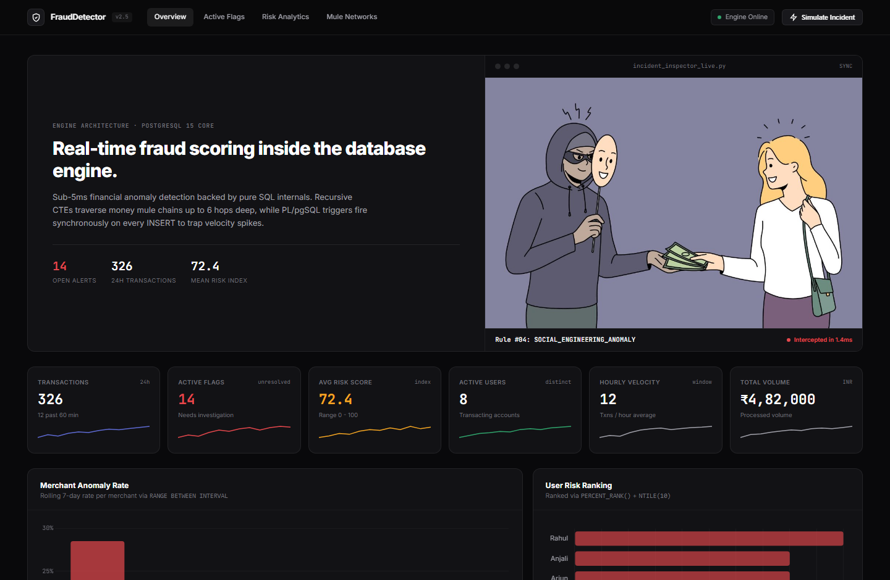

<div align="center">



# FraudDetector

**Real-time transaction fraud detection — PostgreSQL · Python · FastAPI**

[](https://frauddetector-dashboard.vercel.app)
[](https://github.com/ansh44233/FraudDetector/actions/workflows/ci.yml)
[](https://python.org)
[](https://postgresql.org)
[](tests/)
[](LICENSE)

<div align="center">


</div>

Detects fraud patterns in real time using nothing but advanced PostgreSQL. No ML models, no third-party services — everything runs through a rules engine backed by raw SQL. Flags appear within milliseconds of a transaction insert via PL/pgSQL triggers; the rest runs on demand or on schedule.

**[Live demo →](https://frauddetector-dashboard.vercel.app)**

```
transaction INSERT → PL/pgSQL triggers → rules engine → fraud_flags → dashboard
```

---

## What it detects

| Pattern | Rule | Score |
|---|---|---|
| >5 transactions in 10 minutes | `VELOCITY_10M` | 85 |
| Same user+merchant repeat < 60 s | `RAPID_REPEAT` | 70 |
| Amount > 5× user's own average | `HIGH_AMOUNT_ANOMALY` | 75 |
| 3+ devices in 1 hour | `MULTI_DEVICE_1H` | 80 |
| Money mule chain ≥ 2 hops | `MULE_CHAIN` | 90 |
| High-risk merchant + large amount | `HIGH_RISK_MERCHANT` | 65 |
| One device used by multiple users | `SHARED_DEVICE` | 60 |

---

## Advanced SQL

| Technique | Where |
|---|---|
| Recursive CTE | Mule chain tracing — up to 6 hops, cycle guard via `ARRAY` |
| `LATERAL` join | Per-user velocity window; rapid-repeat detection |
| `RANGE BETWEEN INTERVAL` | Rolling 7-day merchant fraud rate |
| `PERCENT_RANK` + `NTILE(10)` | User risk percentile ranking |
| `DENSE_RANK` | Global fraud leaderboard |
| `LAG` / `LEAD` | Time gap between consecutive transactions |
| Materialized view | Pre-computed per-user risk stats, refresh on demand |
| PL/pgSQL triggers | Auto-flag on insert — high-amount anomaly + multi-device |
| `JSONB` | Structured flag metadata — ratio, depth, device count |

<details>
<summary><strong>Recursive CTE — money mule chain (up to 6 hops)</strong></summary>

```sql
WITH RECURSIVE chain AS (
    SELECT tg.from_user_id, tg.to_user_id, tg.txn_id,
           ARRAY[tg.from_user_id] AS visited, 1 AS depth
    FROM transaction_graph tg
    JOIN fraud_flags ff ON ff.txn_id = tg.txn_id
    WHERE ff.resolved = FALSE

    UNION ALL

    SELECT tg.from_user_id, tg.to_user_id, tg.txn_id,
           c.visited || tg.from_user_id, c.depth + 1
    FROM transaction_graph tg
    JOIN chain c ON tg.from_user_id = c.to_user_id
    WHERE NOT (tg.from_user_id = ANY(c.visited))  -- cycle guard
      AND c.depth < 6
)
SELECT * FROM chain ORDER BY depth DESC;
```
</details>

<details>
<summary><strong>LATERAL join — per-user velocity window</strong></summary>

```sql
SELECT u.id, u.name, recent.txn_count, recent.total_amount
FROM users u
JOIN LATERAL (
    SELECT COUNT(*) AS txn_count, SUM(amount) AS total_amount
    FROM transactions
    WHERE user_id = u.id
      AND created_at >= NOW() - INTERVAL '10 minutes'
) recent ON recent.txn_count > 5;
```
</details>

<details>
<summary><strong>RANGE BETWEEN — rolling 7-day merchant fraud rate</strong></summary>

```sql
SUM(COUNT(ff.id)) OVER (
    PARTITION BY m.id
    ORDER BY DATE(t.created_at)
    RANGE BETWEEN INTERVAL '6 days' PRECEDING AND CURRENT ROW
) AS rolling_7d_flags
```
</details>

<details>
<summary><strong>PL/pgSQL trigger — high-amount anomaly on INSERT</strong></summary>

```sql
CREATE OR REPLACE FUNCTION auto_flag_high_amount()
RETURNS TRIGGER LANGUAGE plpgsql AS $$
DECLARE avg_amt NUMERIC;
BEGIN
    SELECT AVG(amount) INTO avg_amt
    FROM transactions WHERE user_id = NEW.user_id AND id <> NEW.id;

    IF avg_amt IS NOT NULL AND NEW.amount > (avg_amt * 5) THEN
        INSERT INTO fraud_flags (txn_id, rule_name, risk_score, details)
        VALUES (NEW.id, 'HIGH_AMOUNT_ANOMALY', 75.0,
            jsonb_build_object('amount', NEW.amount,
                               'ratio', ROUND(NEW.amount / avg_amt, 2)));
    END IF;
    RETURN NEW;
END;
$$;
```
</details>

---

## Quickstart

```bash
git clone https://github.com/ansh44233/FraudDetector
cd FraudDetector

# Docker — recommended
docker compose up -d db api
docker compose run --rm seed
# open http://localhost:8000
```

<details>
<summary>Manual setup</summary>

```bash
python -m venv venv && venv\Scripts\activate
pip install -r requirements.txt

psql -U postgres -c "CREATE DATABASE frauddetector;"
psql -U postgres -d frauddetector -f db/schema.sql

copy .env.example .env     # fill in your DB password

python pipeline/seed.py
uvicorn api.main:app --reload
```
</details>

---

## API

```
POST /transactions                   submit transaction (rules run async)

GET  /flags                          open fraud flags
GET  /flags?resolved=true            resolved flags
PATCH /flags/{id}                    resolve / unresolve

GET  /analytics/velocity             users with >5 txns in 10 min
GET  /analytics/merchant-fraud-rate  rolling 7-day rate per merchant
GET  /analytics/mule-chains          recursive CTE chain results
GET  /analytics/device-sharing       shared device detection
GET  /analytics/user-risk-ranking    PERCENT_RANK + NTILE ranking
GET  /analytics/summary              dashboard KPIs

POST /engine/run                     manually trigger rules engine
GET  /users/risk-stats               materialized view — user risk stats
```

<details>
<summary>Example — submit a transaction and see flags</summary>

```bash
# create a transaction
curl -X POST http://localhost:8000/transactions \
  -H "Content-Type: application/json" \
  -d '{"user_id":1,"merchant_id":3,"amount":95000,"channel":"UPI","device_id":"device_x"}'

# {"txn_id":61,"txn_ref":"...","message":"Transaction submitted. Rules engine running."}

# check what got flagged
curl http://localhost:8000/flags?resolved=false

# [{"rule_name":"HIGH_AMOUNT_ANOMALY","risk_score":75.0,"details":{"amount":95000,"ratio":475.0},...}]

# mule chain detection
curl http://localhost:8000/analytics/mule-chains

# [{"from_user_id":5,"to_user_id":11,"depth":3,"chain":[5,11,12],...}]
```
</details>

---

## Tests

```bash
pytest tests/ -m "not integration"          # unit — no DB needed
pytest tests/ -m integration               # integration — needs Postgres
```

| File | Tests | Type |
|---|---|---|
| `tests/test_rules.py` | 18 | unit — all 5 rules + `_flag` + `run_all_rules` |
| `tests/test_api.py` | 20 | unit — all endpoints mocked |

---

## Stack

| Layer | Tech |
|---|---|
| Database | PostgreSQL 15 — raw SQL, no ORM |
| API | FastAPI + Pydantic v2 |
| Rules engine | Python + psycopg2 |
| Dashboard | Vanilla JS + Chart.js |
| Tests | pytest + httpx |
| CI | GitHub Actions — Python 3.11 + 3.12 |
| Deploy | Docker + docker-compose · dashboard on Vercel |

---

## Roadmap

- [x] Velocity burst — `VELOCITY_10M`
- [x] Rapid repeat — `RAPID_REPEAT`
- [x] High-amount anomaly — PL/pgSQL trigger
- [x] Multi-device trigger — `MULTI_DEVICE_1H`
- [x] Money mule chains — recursive CTE, 6 hops
- [x] Shared device detection
- [x] Materialized view — per-user risk stats
- [x] Docker + docker-compose
- [x] GitHub Actions CI
- [ ] WebSocket — push new flags to dashboard live
- [ ] ML layer — Isolation Forest anomaly score on top of rule scores
- [ ] D3.js — interactive mule chain network graph
- [ ] Auth — API key middleware, per-key rate limiting
- [ ] pg_cron — scheduled materialized view refresh

---

## Contributing

Fork → branch → PR against `initial-release`.

```bash
git clone https://github.com/ansh44233/FraudDetector
cd FraudDetector
python -m venv venv && venv\Scripts\activate
pip install -r requirements.txt
pytest tests/ -m "not integration"   # must be green before you push
```

Good first issues:
- **`IP_REPUTATION` rule** — flag IPs appearing across >3 user accounts
- **`GET /flags/{id}`** — single flag with full transaction detail
- **Integration tests** — `test_integration_db.py` against a real Postgres test DB
- **GIN index on `details`** — `CREATE INDEX ON fraud_flags USING GIN (details)` and benchmark

---

## Star History

<div align="center">

[](https://star-history.com/#ansh44233/FraudDetector&Date)

</div>

---

MIT © [Ansh](https://github.com/ansh44233)
